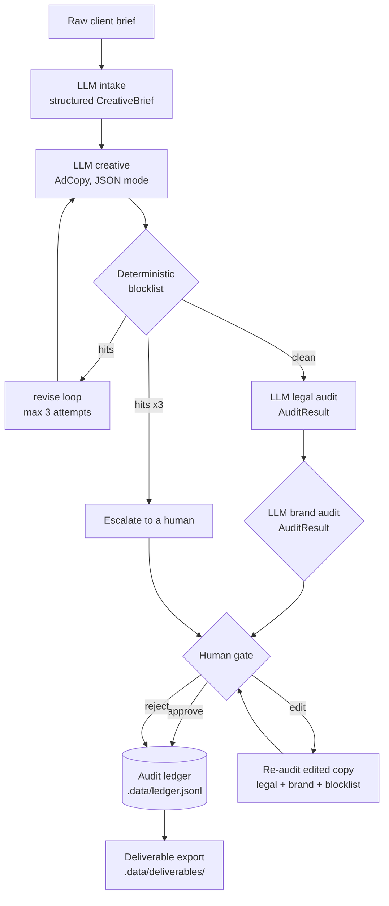

# Architecture

Safety-first ad-copy pipeline. The design rule is simple: **the model drafts,
deterministic code and humans decide.** Nothing below the human gate is
published on model authority alone.

## Pipeline

## Safety layers, in order of trust

| # | Layer | Type | Can be bypassed? |
|---|-------|------|------------------|
| 1 | Deterministic 16-term whole-word blocklist | Code | No |
| 2 | Retry cap (≤3) + quota guard (`.data/quota.json`) | Code | No (fails closed) |
| 3 | Legal audit + brand audit | LLM (first-pass filter only) | Irrelevant to 1 |
| 4 | Human gate | Human | The only authority |
| 5 | Audit ledger (append-only) | Record | Tamper-evident |
| 6 | `--edited-copy` + `--include-unsafe` export refusals | Code | Explicit, logged |

## Trust boundaries

- **Provider → repo**: responses are JSON-extracted and pydantic-validated.
  Schema violations retry within the hard cap; after the cap they abort the
  run. Nothing is `eval`'d; prompts never include tool output; no HTML or
  markdown from the model is rendered unescaped.
- **Repo → client**: only `approved` ledger entries export. Unsafe approvals
  need an explicit flag; existing deliverable directories are never
  overwritten.
- **Operator → provider**: keys come from the environment only; requests carry
  HARM_CATEGORY_* safety settings; error bodies are truncated before logging;
  the model id is never hardcoded (missing config fails loudly at call time).

## Data flow & persistence

| Artifact | Location | Contains | Lifecycle |
|---|---|---|---|
| Ledger | `.data/ledger.jsonl` | Briefs, copy, decisions | Append-only, gitignored |
| Quota state | `.data/quota.json` | `{"day", "used"}` | Atomic rewrite, gitignored |
| Deliverables | `.data/deliverables/<id>/` | Client-ready package | Manual cleanup |

## Invariants a change must not break

1. `reviewed_by_human` stays `False` until a real person approves.
2. The blocklist runs before the audits, and its floor cannot be talked away.
3. Heldout fixtures are never used for tuning.
4. Free-tier quota is for testing; the daily guard fails closed.
5. `.env` and `.data/` are never committed.
